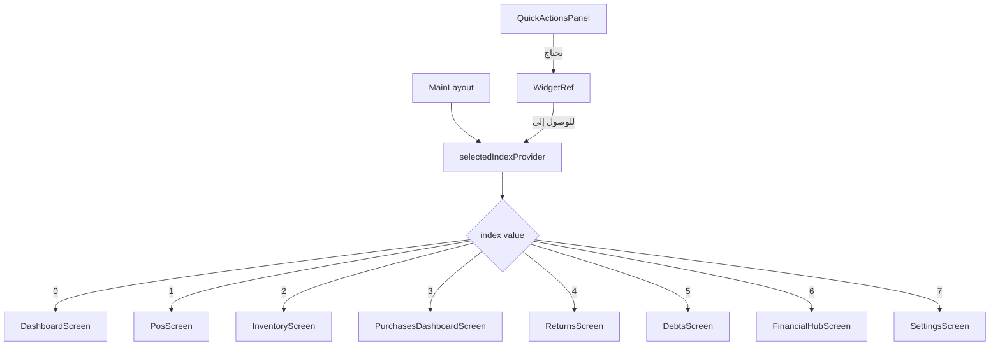

# خطة إصلاح صفحة التقارير وحل مشاكل التنقل

## 📋 ملخص المشكلة

صفحة [`QuickActionsPanel`](lib/features/reports/presentation/widgets/quick_actions_panel.dart) تحتوي على ثلاثة TODO للتنقل:
1. **إضافة معاملة جديدة** - يجب الانتقال إلى POS Screen
2. **تسجيل عميل جديد** - يجب الانتقل إلى Debts Screen  
3. **تقرير المخزون** - يجب الانتقال إلى Inventory Screen

### السبب الجذري للمشكلة

الـ [`QuickActionsPanel`](lib/features/reports/presentation/widgets/quick_actions_panel.dart:5) هو `StatelessWidget` عادي ولا يملك وصول إلى `WidgetRef` مما يمنعه من:
- الوصول إلى `selectedIndexProvider` لتغيير الصفحة
- استخدام نظام التنقل الموحد في التطبيق

---

## 🏗️ هيكل التنقل في التطبيق



### جدول الفهارس

| الفهرس | الشاشة | الاستخدام |
|--------|--------|----------|
| 0 | DashboardScreen | الرئيسية |
| 1 | PosScreen | نقطة البيع - إضافة معاملة |
| 2 | InventoryScreen | المخزون - تقرير المخزون |
| 3 | PurchasesDashboardScreen | المشتريات |
| 4 | ReturnsScreen | المرتجعات |
| 5 | DebtsScreen | الديون - إضافة عميل |
| 6 | FinancialHubScreen | التقارير |
| 7 | SettingsScreen | الإعدادات |

---

## 🔧 الحل المقترح

### الخطوة 1: تحويل QuickActionsPanel إلى ConsumerWidget

```dart
// قبل
class QuickActionsPanel extends StatelessWidget {
  const QuickActionsPanel({super.key});
  // ...
}

// بعد
class QuickActionsPanel extends ConsumerWidget {
  const QuickActionsPanel({super.key});
  // ...
}
```

### الخطوة 2: إضافة WidgetRef للـ build method

```dart
@override
Widget build(BuildContext context, WidgetRef ref) {
  // الآن يمكننا استخدام ref للوصول إلى Providers
}
```

### الخطوة 3: تنفيذ التنقل باستخدام selectedIndexProvider

```dart
// إضافة معاملة جديدة - الانتقال إلى POS
onTap: () {
  ref.read(selectedIndexProvider.notifier).state = 1;
},

// تسجيل عميل جديد - الانتقال إلى Debts
onTap: () {
  ref.read(selectedIndexProvider.notifier).state = 5;
},

// تقرير المخزون - الانتقال إلى Inventory
onTap: () {
  ref.read(selectedIndexProvider.notifier).state = 2;
},
```

### الخطوة 4: إضافة import ضروري

```dart
import '../../../dashboard/presentation/screens/main_layout.dart';
```

---

## 📝 الكود الكامل المعدل

```dart
import 'package:flutter/material.dart';
import 'package:flutter_riverpod/flutter_riverpod.dart';
import '../../../../core/theme/app_colors.dart';
import '../../../dashboard/presentation/screens/main_layout.dart';

/// لوحة الإجراءات السريعة
class QuickActionsPanel extends ConsumerWidget {
  const QuickActionsPanel({super.key});

  @override
  Widget build(BuildContext context, WidgetRef ref) {
    return Container(
      padding: const EdgeInsets.all(16),
      decoration: BoxDecoration(
        color: Colors.white,
        borderRadius: BorderRadius.circular(16),
        boxShadow: const [
          BoxShadow(
            color: AppColors.cardShadow,
            blurRadius: 10,
            offset: Offset(0, 4),
          ),
        ],
      ),
      child: Column(
        crossAxisAlignment: CrossAxisAlignment.start,
        children: [
          const Text(
            'إجراءات سريعة',
            style: TextStyle(
              fontFamily: 'Tajawal',
              fontSize: 18,
              fontWeight: FontWeight.bold,
              color: AppColors.textPrimary,
            ),
          ),
          const SizedBox(height: 16),
          _buildActionButton(
            icon: Icons.add_circle_outline,
            label: 'إضافة معاملة جديدة',
            color: const Color(0xFFFFF3CD),
            iconColor: AppColors.warning,
            onTap: () {
              // الانتقال إلى نقطة البيع
              ref.read(selectedIndexProvider.notifier).state = 1;
            },
          ),
          const SizedBox(height: 10),
          _buildActionButton(
            icon: Icons.person_add_outlined,
            label: 'تسجيل عميل جديد',
            color: const Color(0xFFFFF3CD),
            iconColor: AppColors.warning,
            onTap: () {
              // الانتقال إلى إدارة الديون
              ref.read(selectedIndexProvider.notifier).state = 5;
            },
          ),
          const SizedBox(height: 10),
          _buildActionButton(
            icon: Icons.inventory_2_outlined,
            label: 'تقرير المخزون',
            color: const Color(0xFFFFF3CD),
            iconColor: AppColors.warning,
            onTap: () {
              // الانتقال إلى المخزون
              ref.read(selectedIndexProvider.notifier).state = 2;
            },
          ),
        ],
      ),
    );
  }

  Widget _buildActionButton({
    required IconData icon,
    required String label,
    required Color color,
    required Color iconColor,
    required VoidCallback onTap,
  }) {
    return Material(
      color: color,
      borderRadius: BorderRadius.circular(12),
      child: InkWell(
        onTap: onTap,
        borderRadius: BorderRadius.circular(12),
        child: Padding(
          padding: const EdgeInsets.symmetric(horizontal: 16, vertical: 14),
          child: Row(
            children: [
              Expanded(
                child: Text(
                  label,
                  style: const TextStyle(
                    fontFamily: 'Tajawal',
                    fontSize: 14,
                    fontWeight: FontWeight.w600,
                    color: AppColors.textPrimary,
                  ),
                ),
              ),
              Container(
                width: 32,
                height: 32,
                decoration: BoxDecoration(
                  color: Colors.white.withValues(alpha: 0.7),
                  borderRadius: BorderRadius.circular(8),
                ),
                child: Icon(icon, size: 18, color: iconColor),
              ),
            ],
          ),
        ),
      ),
    );
  }
}
```

---

## ⚡ تحسينات الأداء المقترحة

### 1. تحسين ReportsRepositoryImpl

المشكلة: دالة `getTopProducts` تقوم بـ N+1 queries:

```dart
// المشكلة الحالية
for (final sale in filteredSales) {
  final items = await _salesDao.getSaleItems(sale.id); // استعلام لكل عملية بيع
  // ...
}
```

**الحل**: إنشاء دالة محسنة في SalesDriftDao:

```dart
// في SalesDriftDao
Future<List<SaleItemWithSale>> getAllSaleItemsWithSales(DateTime from, DateTime to) async {
  // Join query واحد بدلاً من N queries
}
```

### 2. إضافة Caching للتقارير

```dart
final financialReportProvider = FutureProvider<FinancialReport>((ref) async {
  final period = ref.watch(selectedPeriodProvider);
  final repo = ref.watch(reportsRepositoryProvider);
  
  // إضافة autoDispose لإعادة تحميل البيانات عند الحاجة
  // أو استخدام keepAlive للإبقاء على البيانات
  return repo.getFinancialReport(period);
}).autoDispose(); // أو بدون autoDispose حسب الحاجة
```

### 3. تحسين DebtsOverviewTable

إضافة `const` حيثما أمكن وتجنب إعادة البناء غير الضرورية.

---

## ✅ قائمة المهام للتنفيذ

- [ ] تحويل `QuickActionsPanel` من `StatelessWidget` إلى `ConsumerWidget`
- [ ] إضافة import لـ `main_layout.dart`
- [ ] تنفيذ التنقل لـ POS Screen (index 1)
- [ ] تنفيذ التنقل لـ Debts Screen (index 5)
- [ ] تنفيذ التنقل لـ Inventory Screen (index 2)
- [ ] اختبار التنقل من صفحة التقارير
- [ ] مراجعة الأداء وإضافة التحسينات إن لزم

---

## 🎯 ملاحظات إضافية

### لماذا فشلت المحاولات السابقة؟

1. **محاولة استخدام Navigator.push**: التطبيق يستخدم نظام sidebar داخلي وليس routes تقليدية
2. **عدم الوصول إلى selectedIndexProvider**: الـ widget لم يكن ConsumerWidget
3. **عدم فهم هيكل التنقل**: التطبيق لا يستخدم named routes بل index-based navigation

### بديل: استخدام NotificationRouter

يمكن أيضاً استخدام نمط [`NotificationRouter`](lib/core/navigation/notification_router.dart) كمرجع:

```dart
// مثال من NotificationRouter
ref.read(selectedIndexProvider.notifier).state = targetIndex;
```

هذا هو نفس النمط المستخدم في الإشعارات ويمكن تطبيقه هنا.
